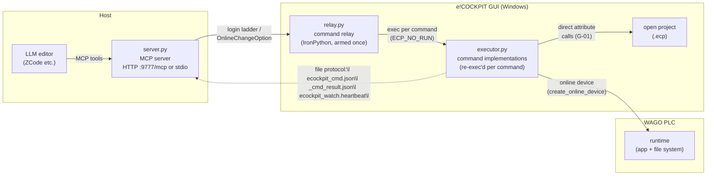

# Architecture

Three parts, one file protocol. Everything that runs on the e!COCKPIT
machine ships in this package; the only external input is your
automation project (`ECP_PROJECT_ROOT`).

## The three parts

- **`server.py`** (host, CPython ≥ 3.10) — the MCP server editors
  connect to. Validates arguments, enforces the confirm-gate refusals,
  routes commands over the file protocol, adds `log_tail` to failures.
  Exposes 49 tools across build/import/export, online I/O, libraries,
  tree/ST authoring, task/symbol config, device scan/comm/params, and
  project lifecycle.
- **`relay.py`** (inside e!COCKPIT, IronPython 2.7) — armed once per
  session via FILE → Scripting → Execute script file. Creates its work
  dir, writes the heartbeat, polls `ecockpit_cmd.json`, exec()s
  `executor.py` once per command (so executor edits go live without
  re-arming), and writes id-matched results.
- **`executor.py`** — the command implementations. Runs inside the
  engine with the injected globals (`system`, `e_projects`, `online`,
  `librarymanager`, …); keeps guarded stand-ins for every injected
  name so it stays lintable/importable offline.

## Domains

| Domain | Commands |
|---|---|
| Build | build, import, compile, rebuild, export, snapshot |
| Online | read, write, unforce, state, login, prepared_values, download, source_download, stop, disconnect |
| PLC files | plcfs (ls/get/put/rm/rename/mkdir/rmdir), upload_source |
| Libraries | libs, lib_find, lib_install, lib_uninstall, repos, repo_add/remove/update/move |
| Tree/ST | tree, object_create, textual |
| App/project | task_config, symbol_config, device_scan, device_comm, device_params, app_control, project_control |
| Diagnostics | status (server), messages, probe, clear_messages |

## Invariants

- One `.env` for all three parts (search: script dir, then up two
  parent levels — never the cwd).
- File-protocol file names are stable
  (`ecockpit_cmd.json`, `ecockpit_cmd_result.json`,
  `ecockpit_watch.heartbeat`, `ecockpit_server.stop`).
- The executor must stay IronPython 2.7-compatible and lint-clean under
  CPython (`ECP_NO_RUN=1` for offline imports; GOTCHAS G-06).
- Every online command logs in via the online-change ladder
  (G-09); read-only commands prefer `OnlineChangeOption.Keep`.
